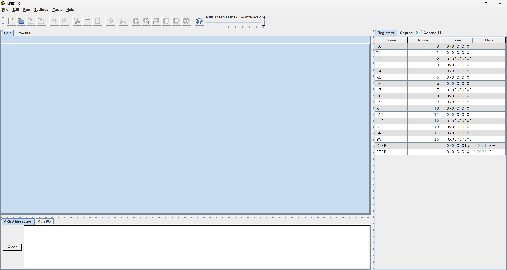

<p align="center"></p>

# ARES: ARM Educational Simulator

ARES is a desktop program for writing, assembling, running and debugging ARMv7 assembly language, made for teaching. It puts an editor, a debugger and visual teaching tools in one program, so beginners can see exactly what their program does, step by step. Programs written for CPUlator's ARMv7 DE1-SoC system assemble in ARES, with their instructions and registers in capitals (Edit > Capitalize Instructions does that).

**Website:** [ay199x.github.io/ARES](https://ay199x.github.io/ARES/), with the downloads and the Help online.



## Features
- An editor with syntax colours, several open files, and find and replace.
- The GNU assembler and linker included; the assembler runs with CPUlator's options.
- Run, step, backstep and breakpoints, with views of the registers, the floating-point registers, memory and labels.
- System calls for text and number input and output, files and dialogs, and the DE1-SoC's JTAG UART.
- Teaching tools, each in its own window: the ARM X-Ray (an animated single-cycle datapath), the Dynamic Instruction Counter, a Data Cache Simulator, Memory Reference Visualization, a Bitmap Display, Floating Point Representation, a BHT Simulator, a Keyboard and Display MMIO Simulator and the Digital Lab Sim.
- A built-in Help listing every instruction, pseudo-instruction and system call, and example programs under File > Open Example.

## Download
Get the latest version from the [Releases page](https://github.com/ay199x/ARES/releases/latest).

| File | System |
|---|---|
| `ARES.exe` | Windows 10 or 11, 64-bit: one file to run |
| `ARES-windows.zip` | the same as a folder, with the example programs beside it |
| `ARES-macos-arm64.zip` | macOS 12 or newer, Apple Silicon |

Packages for Linux and for Intel Macs will follow on the same page; until then, run ARES from source (see below).

ARES is not signed, so the first time you start it, your system asks:

- **Windows:** in the SmartScreen message, choose **More info > Run anyway**.
- **macOS:** unzip the file and open ARES once, then choose **Open Anyway** in **System Settings > Privacy & Security** (on macOS 12: **System Preferences > Security & Privacy**).

## A first program

```
        .data
hello:  .asciz  "Hello, world!\n"

        .global _start
        .text
_start: LDR     R0, =hello      @ R0 = the address of the text
        SVC     #4              @ print the string
        SVC     #10             @ end the program
```

Press F3 to assemble and F5 to run. Help > Help explains the rest.

## Documentation
Everything is in ARES itself: Help > Help lists every instruction, pseudo-instruction and system call, explains the directives, the registers, the memory map and each tool, and File > Open Example opens example programs to learn from. The [website](https://ay199x.github.io/ARES/help/intro.html) has the Help's pages on the program, the system calls and the tools; the instruction lists, the directives, the registers and the memory map are in ARES only.

## Building from source
With Python 3.11 or newer (on Linux 3.12 or newer, with `python3-tk` and `xvfb` for the tests), on the system you build for:

```
python3 -m venv .venv
.venv/bin/python -m pip install -r requirements-dev.txt
.venv/bin/python tools/build.py
```

On Windows write `py` for `python3` and `.venv\Scripts\python` for `.venv/bin/python`. `tools/build.py` fetches the GNU assembler and linker, runs the tests and leaves the packages in `dist`. To run ARES without building it: `.venv/bin/python tools/fetch_toolchain.py`, then `.venv/bin/python -m ares`.

## Why ARES
MARS made MIPS assembly easy to learn, but ARM had nothing like it, and the closest, CPUlator, is hard for beginners. ARES is an easy simulator for ARMv7 that university labs can use. Ares is the Greek name of the god the Romans called Mars, so ARES and MARS mean the same thing in two languages.

## Credits
Created by Ayush Shashikant Pindoria.

Advisors:
- Ronald F. DeMara, Ph.D., P.E., Pegasus Professor, Department of Electrical and Computer Engineering, University of Central Florida; Fellow of IEEE and AAAS
- Paul Amoruso, Ph.D., Assistant Professor of Computer Engineering, Florida Polytechnic University

First used in the EEL 3801 Computer Organization labs at the University of Central Florida.

## Acknowledgements
- Inspired by [MARS](https://dpetersanderson.github.io/) and its tools.
- Compatible with the ARMv7 syntax of [CPUlator](https://cpulator.01xz.net/).
- Built on [GNU binutils](https://www.gnu.org/software/binutils/), [Unicorn](https://www.unicorn-engine.org/) and [Capstone](https://www.capstone-engine.org/).
- The Dynamic Instruction Counter is based on DynARMic: [DynARMic: A Dynamic ARM Instruction Counting Tool](https://doi.org/10.1145/3787109.3815320), GLSVLSI 2026.
- The ARM X-Ray follows the single-cycle ARM processor of Harris and Harris, *Digital Design and Computer Architecture: ARM Edition*.

## Licence
ARES is open source: anyone may use, study, change and share it, and changed versions that are shared must stay open source too. It is licensed under GPL-2.0-or-later (see `LICENSE`). `THIRD_PARTY_NOTICES.txt` lists the components it includes, their licences and where their source code is published.
